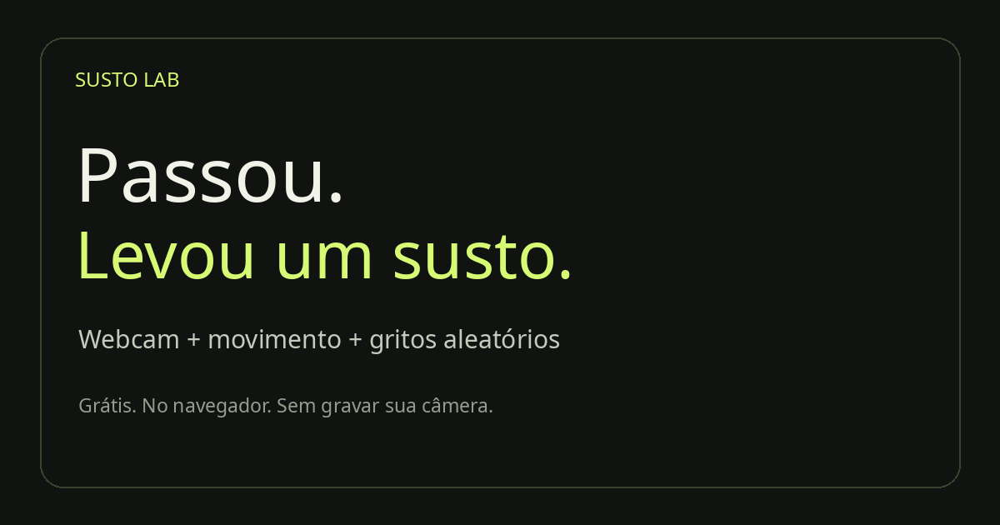

# Susto Lab 👻

Detector de movimento com webcam que toca gritos aleatórios, direto no navegador. Gratuito, sem cadastro e sem gravar ou transmitir imagens.

**[Abrir aplicativo](https://andrewalkermo.github.io/susto/)** · [Reportar problema](https://github.com/andrewalkermo/susto/issues)



## Como usar

1. Abra o aplicativo em um navegador com webcam e permita o acesso à câmera.
2. Clique em **Testar som** e ajuste o volume.
3. Ajuste a sensibilidade e o **Atraso antes do grito** (0 a 5 segundos; padrão 0,3 s).
4. Clique em **Ativar sustos**. Há cinco segundos para sair da frente.
5. Opcionalmente, ligue o **Ambiente assombrado**, com volume independente.
6. Para esconder a imagem e o painel, clique em **Modo oculto · tela preta**.

**Esc ou clique duplo** sai da tela preta. **Esc no painel** desliga os sons e libera a câmera. O botão Desativar sustos também para tudo.

## Recursos

- Câmera ao vivo e detecção local de movimento.
- Cinco gritos em MP3, sorteados sem repetição imediata; também é possível escolher um ou importar arquivos próprios.
- Sensibilidade e volume ajustáveis.
- Atraso antes do grito de 0 a 5 segundos, em passos de 0,1 segundo.
- Intervalo entre sustos de 5, 10, 20, 30 ou 60 segundos, contado após o áudio.
- Vento discreto, graves, rangidos, assobios e risadinhas distantes.
- Ambientação independente da câmera, com redução de volume durante os gritos.
- Modo oculto com tela preta e cursor escondido.

## Requisitos e limites

Use HTTPS ou `localhost`: abrir `index.html` diretamente não é suficiente para a câmera. Navegadores exigem interação inicial para liberar o áudio. Teste com sua câmera e iluminação antes de deixar funcionando.

A detecção compara imagens, **não reconhece pessoas**. Luzes, sombras e objetos podem dispará-la. Uma câmera com pouca luz ou baixa taxa de quadros pode responder mais devagar. A reprodução por Bluetooth também pode adicionar atraso.

É possível trocar de aba, mas o navegador pode limitar timers, suspender a câmera ou descartar abas. A aba precisa continuar aberta, o notebook acordado e a câmera conectada. O modo oculto esconde o conteúdo da página; não esconde indicadores de câmera nem a interface do navegador.

As configurações e os áudios importados ficam nesta sessão; recarregar volta aos padrões. Comece com volume baixo e use a brincadeira em contexto apropriado para quem participa.

## Privacidade

Não há backend, contas, analytics, cookies de rastreamento nem upload de câmera ou áudio importado. Os quadros são processados em memória no navegador. As gravações de áudio incluídas são servidas junto com o site.

O GitHub Pages recebe as requisições normais de hospedagem. As fontes opcionais são carregadas pelo Google Fonts, que recebe requisições de rede; se indisponíveis, o aplicativo usa fontes locais. O app não envia imagens a esses serviços.

## Executar localmente

Requisitos de desenvolvimento: Python 3 para servir os arquivos e Node.js 22 ou superior para as verificações. Não há dependências npm nem etapa de compilação.

```bash
git clone https://github.com/andrewalkermo/susto.git
cd susto
python3 -m http.server 8080 --directory dist
```

Abra [http://localhost:8080](http://localhost:8080). Para acessar de outro dispositivo, sirva com HTTPS; HTTP em um IP da rede local geralmente não libera a câmera.

## Estrutura e funcionamento

| Arquivo | Responsabilidade |
| --- | --- |
| `dist/index.html` | Painel, instruções e metadados de busca/compartilhamento |
| `dist/style.css` | Layout responsivo, vídeo e modo oculto |
| `dist/app.js` | Câmera, áudio, controles, atraso e estado da sessão |
| `dist/motion.js` | Medição de movimento com compensação de exposição |
| `dist/detector-worker.js` | Agendamento de análise em Worker |
| `dist/ambient.js` | Síntese do ambiente e reprodução das risadinhas |
| `dist/audio/` | Cinco gritos e uma gravação de risada |
| `scripts/check.mjs` | Validação de referências locais e metadados |
| `tests/motion.test.cjs` | Cenários sintéticos do detector e atraso |

A câmera é reduzida para 320 × 240. O agendador solicita uma análise a cada 40 ms, sem garantir essa frequência em todos os dispositivos. O detector compara luminância entre quadros, compensa mudanças uniformes de exposição e exige suporte espacial para rejeitar ruído isolado. Na sensibilidade máxima, o limiar de área é 0,08% e o de contraste é 8 níveis. Um movimento válido agenda uma única reação com o atraso escolhido; desativar cancela a reação pendente.

Os gritos são carregados e decodificados antes de armar a câmera. Trechos silenciosos iniciais conhecidos são pulados na reprodução. Nenhum download é necessário no momento do susto. Os arquivos originais permanecem intactos.

## Verificar e contribuir

```bash
node scripts/check.mjs
node --test tests/*.test.cjs
```

O CI também verifica a sintaxe do JavaScript. Para contribuir, abra uma issue ou um pull request com a mudança e a validação realizada. Mudanças na câmera e áudio devem ser verificadas manualmente em um navegador real; testes sintéticos não medem latência física nem permissões.

## Publicação no GitHub Pages

O workflow `.github/workflows/pages.yml` valida o código e publica somente `dist/` em pushes para `main` ou por execução manual. Em **Settings → Pages → Source**, use **GitHub Actions**. Não são necessários segredos adicionais.

Para um fork, atualize o domínio e o caminho nos metadados de `index.html`, no `sitemap.xml`, no `robots.txt` e neste README. Ative Pages no seu repositório. Caminhos de scripts, estilos e áudio são relativos para funcionar em `/susto/`.

## Busca e compartilhamento

O site inclui descrição em português, URL canônica, Open Graph, Twitter Card, imagem PNG 1200 × 630, favicon, dados estruturados `WebApplication`, conteúdo explicativo visível, `robots.txt` e sitemap. Isso permite rastreamento e melhora a apresentação de links; não garante posição ou prazo de indexação. Se desejar acompanhar indexação no Google, o proprietário pode verificar o site no Search Console e enviar o sitemap.

## Licenças e créditos

O **código original** usa a [licença MIT](LICENSE). Os **áudios de terceiros** têm seus próprios termos, listados em [CREDITS.md](CREDITS.md); não são relicenciados pela MIT. Os sons sintetizados são criados pelo código local. Fontes opcionais: DM Sans e Space Grotesk, distribuídas pelo Google Fonts sob OFL.
